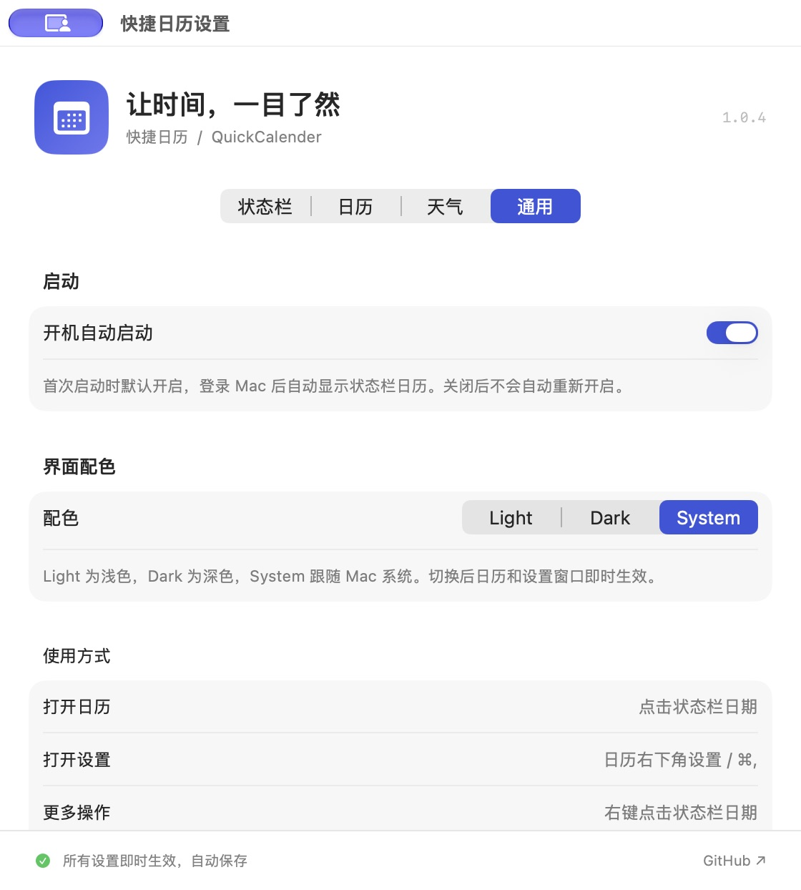

# 快捷日历 · QuickCalender

一个轻巧的原生 macOS 状态栏日历。点开日期，就能看见月历、农历、中国节日和城市天气。

## 下载安装

**[下载 DMG · v1.0.4](https://github.com/chenzhen411/QuickCalender/releases/download/v1.0.4/QuickCalender-1.0.4-macOS-arm64.dmg)** · [查看最新版本](https://github.com/chenzhen411/QuickCalender/releases/latest)

适用于 **Apple Silicon（M 系列芯片）Mac，macOS 13 或更新版本**。

1. 下载并打开 DMG，将 `QuickCalender.app` 拖入 `Applications`（应用程序）。
2. 从“应用程序”启动快捷日历，在状态栏点击日期即可展开月历。
3. 首次启动默认开启开机启动，可在“设置 → 通用 → 启动”关闭。

当前安装包使用本地 ad-hoc 签名，尚未进行 Apple Developer ID 签名和公证。

## 界面预览

| 日历界面 | 设置界面 |
| :---: | :---: |
|  |  |

## 功能

- **状态栏**：日期、星期、时间；经典 / 简约 / 完整三种样式，可选图标、秒数及 12 / 24 小时制。
- **月历**：固定六周布局，今天高亮，点击日期查看详情；支持周一或周日为每周首日。
- **年月跳转**：左右切月；点击月份标题，直接选择 1901–2099 年及月份；一键回到今天。
- **农历与节日**：系统中国历法计算农历，包含春节、元宵、端午、中秋、重阳、除夕等传统节日，以及元旦、劳动节、国庆等公历节日。闰月不重复标注农历节日，除夕兼容大小月。
- **日期与天气**：在月历下方用一张卡片展示所选日期、农历、节日及天气；今天显示实时温度和湿度，其他日期显示对应预报。保留日期格天气图标、高低温及降水概率。可选常用城市或搜索全球城市，默认上海。
- **精简界面**：弹窗从月份导航开始，不重复显示应用标题或时钟；日期、星期和时间保留在状态栏。
- **独立设置窗口**：状态栏样式、日历显示内容、天气城市；“通用 → 界面配色”提供 Light、Dark、System，日历与设置窗口即时切换，选择自动保存。
- **开机启动**：安装后首次启动默认添加到 macOS 登录项；可在“设置 → 通用 → 启动”关闭。关闭后重新启动或升级不会再次自动开启；系统要求批准时会提供登录项设置入口。
- **原生体验**：SwiftUI + AppKit，无第三方包依赖，无 Dock 常驻图标；点击其他位置关闭弹出日历，右键状态栏可打开设置或退出。
- **打开与边界**：月历日期信息提前计算并缓存，弹窗预先布局、无展开动画。根据状态栏所在屏幕的可用区域限制宽高并校正位置；天气加载后保持窗口大小，内容过长时内部滚动，设置按钮始终可见。

## 构建和运行

运行要求：macOS 13 Ventura 或更新版本。构建需要 Swift 6.0+（Xcode 16+ 或相应 Command Line Tools）。首次开发前可运行 `xcode-select --install` 安装工具。

```bash
git clone https://github.com/chenzhen411/QuickCalender.git
cd QuickCalender
bash scripts/run.sh
```

安装包位于 `dist/QuickCalender-macOS.zip`。解压后将 `QuickCalender.app` 拖到“应用程序”文件夹，再双击运行。状态栏会出现日期、星期和时间；应用默认不在 Dock 显示。

构建脚本在临时目录完成签名及验证，再生成不含扩展元数据的 ZIP 和 `dist/QuickCalender.app` 副本。这样即使项目位于 iCloud 同步目录，也能获得干净的分发包。`run.sh` 启动经过验证的临时目录中的应用。

```bash
# 仅打包
bash scripts/build.sh

# 运行测试
bash scripts/test.sh

# 开发运行
bash scripts/swift-tool.sh run QuickCalender

# 独立日历预览窗口（便于开发和截图）
dist/QuickCalender.app/Contents/MacOS/QuickCalender --preview

# 启动时直接显示设置
open dist/QuickCalender.app --args --settings

```

也可以使用 Xcode 打开 `Package.swift` 进行开发。运行上述打包脚本生成包含 `Info.plist` 和图标的标准 `.app`。

脚本使用标准 Swift Package Manager，并将构建缓存保存在项目内。

## 操作

| 操作 | 入口 |
| --- | --- |
| 展开 / 收起月历 | 左键点击状态栏日期展开，再次点击收起（年月选择打开时也可收起） |
| 上月 / 下月 | 月历右上角箭头，或 ⌘← / ⌘→ |
| 跳转指定年月 | 点击月历月份标题 |
| 回到今天 | “今天”按钮或 ⌘T |
| 打开设置 | 月历底部“设置”、⌘, 或右键状态栏 |
| 退出 | 月历底部电源图标或右键状态栏菜单 |

## 数据说明

- 公历、时间及农历使用 Mac 的当前系统时区。清明按太阳黄经 15° 的近似天文计算，并使用中国标准时间确定日期。节日是纪念日标签，不代表国务院法定放假及调休安排。
- 天气和城市搜索来自 [Open-Meteo](https://open-meteo.com/)，[天气 API](https://open-meteo.com/en/docs) 及 [地理编码 API](https://open-meteo.com/en/docs/geocoding-api)。预报最多 16 天；超出范围或数据缺失的日期留空，不生成历史或远期天气。
- 天气自动每 30 分钟刷新，失败后最多每 5 分钟重试，也可手动刷新。刷新失败时保留已有数据并显示重试提示和上次更新时间；更换城市后立即清空旧城市数据。
- 当前天气对应所选城市；每日预报按该城市的公历日期匹配日历日期。状态栏时钟始终显示 Mac 系统时间。
- 应用不请求定位权限。设置保存在本机 UserDefaults；天气请求发送所选城市坐标，城市搜索发送输入文本。没有分析或追踪功能。
- Open-Meteo 数据需依照 CC BY 4.0 署名；公共 API 适用于非商业用途。商业分发请使用符合其服务许可的付费或自托管接口。

## 分发

打包脚本生成当前机器架构的应用，并使用本地 ad-hoc 签名。该签名适合本机运行和开发验证；向其他 Mac 分发前，建议配置 Apple Developer ID 签名及公证。

GitHub Actions 在 push / PR 时运行测试、打包，并上传 `QuickCalender-macOS` ZIP 构建产物。Actions 中的构建架构由 runner 决定。

## 项目结构

```text
Sources/CalendarCore/       日历、农历节日、状态栏格式和天气 API
Sources/AppServices/        系统登录项注册、首次启动策略和状态同步
Sources/QuickCalender/      AppKit 生命周期、SwiftUI 月历及设置
Tests/CalendarCoreTests/    日历边界、闰月、节日、时区、天气解析测试
Tests/AppServicesTests/     登录项首次开启、关闭持久化和错误处理测试
Resources/Info.plist        macOS 应用配置
scripts/                   构建、运行和程序化图标生成
```

## 开源许可

本项目采用 [MIT License](LICENSE)，版权所有 © 2026 chenzhen411。

天气数据和服务的使用条款见上方“数据说明”。
